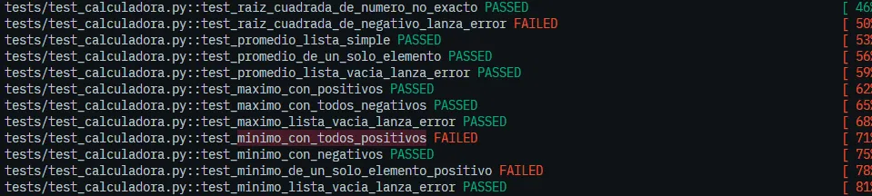
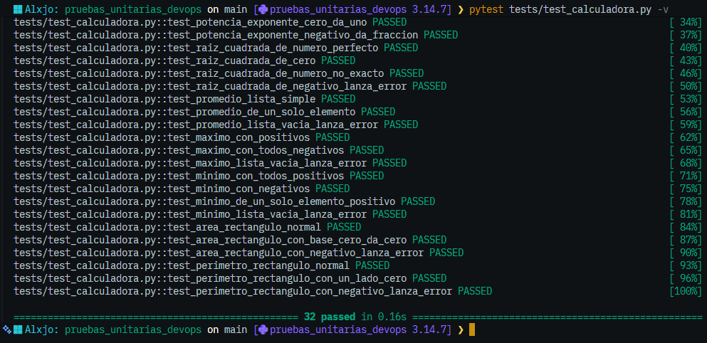
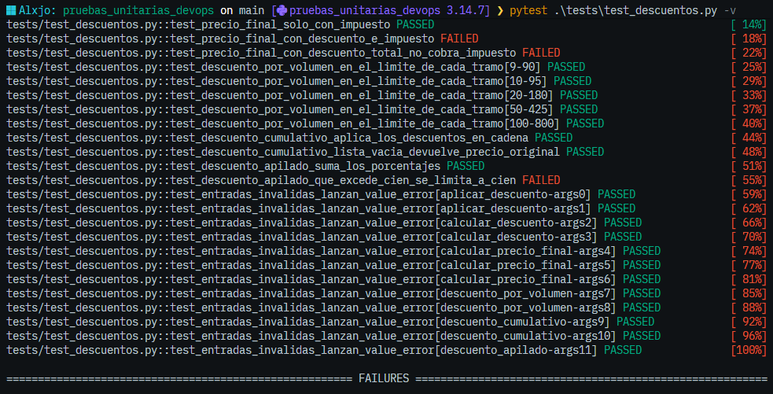
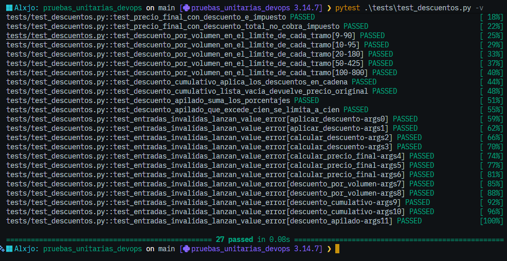
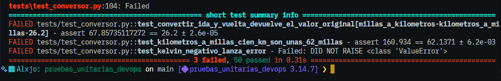
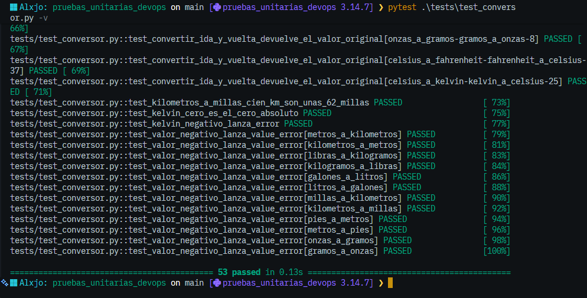
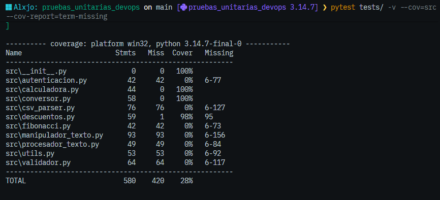

# Informe — Análisis y Mejora de Pruebas Unitarias

## Datos

- **Nombre:** Alejandro Rojas Casas

---

## 1. Módulo `calculadora.py`

### 1.1 Qué hace
Agrupa operaciones matemáticas básicas (`sumar`, `restar`, `multiplicar`, `dividir`, `potencia`, `raiz_cuadrada`), estadísticas sobre listas (`promedio`, `maximo`, `minimo`) y cálculos geométricos de un rectángulo (`calcular_area_rectangulo`, `calcular_perimetro_rectangulo`).

### 1.2 Casos probados y por qué
Escribí 32 pruebas con estructura AAA. Para cada función combiné un caso normal con los casos límite donde el código podía fallar.

| Función | Casos probados | Por qué |
|---|---|---|
| `sumar` | positivos, negativos, suma con cero | el cero es el elemento neutro y los negativos prueban el signo |
| `restar` | resultado negativo | verifica que no asuma resultados positivos |
| `multiplicar` | por cero, dos negativos | el cero anula el resultado y negativo por negativo da positivo |
| `dividir` | decimal, negativos, división por cero | la división por cero debe lanzar `ValueError` |
| `potencia` | exponente positivo, 0 y negativo | el exponente 0 da 1 y el negativo produce una fracción |
| `raiz_cuadrada` | cuadrado perfecto, cero, no exacto, negativo | el negativo no tiene raíz real; el no exacto exige `pytest.approx` |
| `promedio` | lista simple, un elemento, lista vacía | la lista vacía provocaría división por cero |
| `maximo` | positivos, todos negativos, lista vacía | los negativos revelan si el valor inicial está mal elegido |
| `minimo` | todos positivos, con negativos, un elemento, lista vacía | es el caso que reveló el bug 2 |
| `calcular_area_rectangulo` | normal, base cero, lado negativo | el cero es el límite válido y el negativo debe lanzar error |
| `calcular_perimetro_rectangulo` | normal, un lado cero, lado negativo | igual que el área |

### 1.3 Bugs encontrados

| # | Función | Entrada que lo revela | Resultado erróneo | Resultado esperado | Corrección |
|---|---|---|---|---|---|
| 1 | `raiz_cuadrada` | `-4` | Devuelve un número complejo (`1.2e-16+2j`) sin lanzar error | `ValueError` | Se agregó `if numero < 0: raise ValueError(...)` |
| 2 | `minimo` | `[5, 3, 8]` y `[10]` | Devuelve `0` | `3` y `10` | `min_val` arrancaba en `0`; ahora arranca en `lista[0]` |

**Bug 1:** en Python 3, elevar un negativo a `0.5` no lanza error, devuelve un complejo. Es un bug silencioso: el programa sigue con un valor que el resto del código no espera. Elegí `ValueError` por coherencia con `dividir` y `promedio`.

**Bug 2:** `min_val` se iniciaba en `0`. Si todos los números son positivos, ninguno es menor que `0` y la función devuelve `0`, que ni siquiera está en la lista. Con `[4, -7, 2]` sí funcionaba, porque aparece un valor menor que `0`.

### 1.4 Evidencia



Pruebas en verde (después de corregir):



---

## 2. Módulo `descuentos.py`

### 2.1 Qué hace
Calcula precios con descuentos e impuestos. Incluye el descuento simple (`aplicar_descuento`, `calcular_descuento`), el cálculo del precio final con impuesto (`calcular_precio_final`), el descuento por volumen según tramos de cantidad (`descuento_por_volumen`) y dos formas de combinar varios descuentos: en cadena (`descuento_cumulativo`) y sumando porcentajes (`descuento_apilado`).

### 2.2 Casos probados y por qué
Escribí 12 funciones de prueba con estructura AAA, que pytest ejecuta como 27 casos porque dos de ellas usan `parametrize`.

| Función | Casos probados | Por qué |
|---|---|---|
| `aplicar_descuento` | descuento normal (20 %), descuento del 100 % | el 100 % es el límite superior válido y debe dar 0 |
| `calcular_descuento` | descuento normal (25 %) | devuelve el monto del descuento y no el precio final, así que necesita su propia prueba |
| `calcular_precio_final` | solo impuesto, descuento e impuesto juntos, descuento del 100 % | combinar ambos es donde se escondía el bug; con 100 % de descuento no debería cobrarse impuesto |
| `descuento_por_volumen` | un caso en el límite de cada tramo: 9, 10, 20, 50 y 100 unidades | los errores en tramos suelen estar en el borde (`>=` frente a `>`) |
| `descuento_cumulativo` | dos descuentos en cadena, lista vacía | verifica que cada descuento se aplique sobre el precio ya rebajado y que sin descuentos el precio no cambie |
| `descuento_apilado` | suma normal de porcentajes, suma que excede el 100 % | el segundo caso reveló el bug 4 |
| todas las funciones | 12 entradas inválidas (precios, impuestos, porcentajes y cantidades fuera de rango) en una prueba parametrizada | confirma que cada validación lanza `ValueError` |

### 2.3 Bugs encontrados

| # | Función | Entrada que lo revela | Resultado erróneo | Resultado esperado | Corrección |
|---|---|---|---|---|---|
| 3 | `calcular_precio_final` | `(100, 10, 20)` y `(100, 10, 100)` | `90` y `10` | `88` y `0` | el impuesto se calculaba sobre `precio` y ahora se calcula sobre `precio_con_descuento` |
| 4 | `descuento_apilado` | `(100, [60, 50])` | `ValueError` con un mensaje que no corresponde a lo que hizo el usuario | `0` (precio gratis) | se limita el total con `min(total_descuento, 100)` antes de aplicarlo |

**Bug 3:** el código aplica primero el descuento, pero calcula el impuesto sobre el precio original en vez del precio ya rebajado. Con un precio de 100, un descuento del 20 % y un impuesto del 10 %, el resultado correcto es 80 + 8 = 88, pero la función devolvía 80 + 10 = 90. El caso más claro es el del 100 % de descuento: el producto queda gratis y aun así se cobraba impuesto (devolvía 10 en lugar de 0). Lo detectaron `test_precio_final_con_descuento_e_impuesto` y `test_precio_final_con_descuento_total_no_cobra_impuesto`.

**Bug 4:** `descuento_apilado` suma los porcentajes sin comprobar el total. Con `[60, 50]` suma 110, y `aplicar_descuento` rechaza ese valor con el mensaje "El porcentaje debe estar entre 0 y 100", que confunde porque el usuario nunca pasó un 110. Tomé la decisión de diseño de limitar el total al 100 %, de modo que el precio queda en 0, porque el comentario del código describe el problema como que el descuento "puede exceder el 100 %". La alternativa era lanzar un `ValueError` propio con un mensaje claro, que también es válida. Lo detectó `test_descuento_apilado_que_excede_cien_se_limita_a_cien`.

### 2.4 Evidencia

Pruebas en rojo (antes de corregir; fallan 3 casos que corresponden a los 2 bugs):



Pruebas en verde (después de corregir):



---
## 3. Módulo `conversor.py`

### 3.1 Qué hace
Convierte unidades de medida entre sistemas: temperatura (Celsius, Fahrenheit y Kelvin), longitud (metros, kilómetros, millas y pies), masa (libras, kilogramos, onzas y gramos) y volumen (galones y litros). Cada conversión es una función independiente, y las de longitud, masa y volumen rechazan valores negativos con un `ValueError`.

### 3.2 Casos probados y por qué
Escribí 7 funciones de prueba con estructura AAA, que pytest ejecuta como 53 casos porque varias usan `parametrize`. Usé `pytest.approx` para comparar decimales, porque los números en punto flotante tienen pequeños errores de redondeo y comparar con `==` fallaría sin razón.

| Función(es) | Casos probados | Por qué |
|---|---|---|
| Conversiones de temperatura | 100 °C → 212 °F, 0 °C → 32 °F, −40 °C → −40 °F, 212 °F → 100 °C, 0 °C → 273.15 K | son valores de referencia conocidos: ebullición, congelación y el punto donde ambas escalas coinciden |
| `kelvin_a_celsius` | 0 K → −273.15 °C y −1 K lanza `ValueError` | 0 K es el límite válido (cero absoluto) y −1 K está por debajo de lo físicamente posible; este caso reveló el bug 5 |
| Las 12 conversiones de longitud, masa y volumen | un valor conocido por función (por ejemplo 10 lb → 4.53592 kg) | verifica que cada factor de conversión esté bien escrito |
| Las mismas 12 | entrada `0` da `0` | el cero es el límite válido y descarta que la validación esté mal escrita (`<` frente a `<=`) |
| Las mismas 12 | entrada `-1` lanza `ValueError` | confirma que todas las validaciones de valores negativos funcionan |
| 8 pares de conversiones | ida y vuelta (convertir y regresar al valor original) | si dos conversiones inversas no se cancelan, hay un error de fórmula, y se detecta sin conocer el valor correcto de antemano; así apareció el bug 6 |
| `kilometros_a_millas` | 100 km ≈ 62.137 mi | prueba dirigida al bug 6 con un valor fácil de verificar |

### 3.3 Bugs encontrados

| # | Función | Entrada que lo revela | Resultado erróneo | Resultado esperado | Corrección |
|---|---|---|---|---|---|
| 5 | `kelvin_a_celsius` | `-1` | `-274.15` (sin ningún error) | `ValueError` | se agregó `if kelvin < 0: raise ValueError(...)` antes del cálculo |
| 6 | `kilometros_a_millas` | `100` | `160.934` | `≈ 62.137` | se cambió `kilometros * 1.60934` por `kilometros / 1.60934` |

**Bug 5:** `kelvin_a_celsius` restaba 273.15 sin comprobar el rango de entrada. El cero absoluto (0 K) es el límite inferior físico, así que un valor negativo en Kelvin no representa ninguna temperatura real. Con `-1` la función devolvía `-274.15 °C`, un valor imposible, sin avisar. Elegí `ValueError` por coherencia con el resto del módulo, donde las demás conversiones ya lo usan para entradas inválidas. Lo detectó `test_kelvin_negativo_lanza_error`.

**Bug 6:** `kilometros_a_millas` multiplicaba por el factor de conversión de millas a kilómetros en vez de dividir. Como 1 milla equivale a 1.60934 km, pasar de kilómetros a millas exige dividir. Con 100 km devolvía `160.934` cuando el resultado correcto es unas 62.14 millas. Lo detectaron dos pruebas: la dirigida (`test_kilometros_a_millas_cien_km_son_unas_62_millas`) y la de ida y vuelta, donde convertir 26.2 millas a kilómetros y regresar daba `67.857` en lugar de `26.2`, porque el error se aplicaba dos veces.

### 3.4 Evidencia

Pruebas en rojo (el pantallazo muestra los 2 casos que revelan el bug 6; el bug 5 lo reveló `test_kelvin_negativo_lanza_error`, que describí arriba):



Pruebas en verde (después de corregir, 53 casos):



---

## 4. Resumen de bugs

| # | Módulo | Función | Entrada | Erróneo vs esperado | Corrección |
|---|---|---|---|---|---|
| 1 | calculadora | `raiz_cuadrada` | `-4` | número complejo (`1.2e-16+2j`) vs `ValueError` | validar que el número no sea negativo antes de calcular |
| 2 | calculadora | `minimo` | `[5, 3, 8]` y `[10]` | `0` vs `3` y `10` | iniciar `min_val` en `lista[0]` en vez de `0` |
| 3 | descuentos | `calcular_precio_final` | `(100, 10, 20)` | `90` vs `88` | calcular el impuesto sobre `precio_con_descuento` y no sobre el precio original |
| 4 | descuentos | `descuento_apilado` | `(100, [60, 50])` | `ValueError` con mensaje confuso vs `0` | limitar el descuento total con `min(total_descuento, 100)` |
| 5 | conversor | `kelvin_a_celsius` | `-1` | `-274.15` (sin error) vs `ValueError` | validar `if kelvin < 0` y lanzar `ValueError` |
| 6 | conversor | `kilometros_a_millas` | `100` | `160.934` vs `≈ 62.137` | dividir por `1.60934` en vez de multiplicar |

**Total:** 6 bugs corregidos en 3 módulos (2 por módulo), cada uno con su prueba que fallaba antes del fix y pasa después.

---

## 5. Cobertura

Comando:

```
pytest tests/ -v --cov=src --cov-report=term-missing
```

Salida:




---

## 6. Reflexión final

**¿Qué NO mide la cobertura?**

La cobertura solo mide qué líneas de código se ejecutaron mientras corrían las pruebas, no si el código hace lo correcto. Un ejemplo de mi propio trabajo es `minimo`: con una sola prueba como `minimo([4, -7, 2])` se ejecuta todo el ciclo y la función devuelve `-7`, que es correcto, así que el reporte habría marcado esa función como cubierta aunque el bug de `min_val = 0` seguía ahí. El error solo aparece con listas de números positivos, y la cobertura no distingue qué valores probé, solo si la línea corrió.

Además, la cobertura no puede detectar código que **falta**. Tres de mis bugs fueron validaciones ausentes: `raiz_cuadrada` sin revisar los negativos, `descuento_apilado` sin limitar el total al 100 % y `kelvin_a_celsius` sin revisar el cero absoluto. Como no hay una línea que ejecutar, ningún reporte de cobertura las marca como faltantes. Tampoco evalúa la calidad de las pruebas: una prueba sin `assert` suma cobertura sin verificar nada.

**¿Qué aprendí?**

Lo más importante fue cambiar la forma de pensar una prueba: en vez de confirmar que el código funciona, buscar la entrada que lo rompería (un negativo, un cero, un límite). Aprendí que una prueba en rojo es un hallazgo, no un fracaso: los seis bugs que encontré aparecieron porque una prueba falló, y cada fallo me obligó a decidir qué comportamiento era el correcto, como elegir entre limitar el descuento al 100 % o lanzar un error propio. También me quedó la estructura AAA, que hace las pruebas más fáciles de leer y de depurar, y herramientas concretas de pytest como `parametrize`, para cubrir muchos casos sin repetir código, y `pytest.approx`, necesario para comparar decimales por los errores de redondeo del punto flotante.

Otra técnica que me sorprendió por lo útil fue la prueba de ida y vuelta: convertir un valor y regresarlo al original detecta fórmulas invertidas, como la de `kilometros_a_millas`, sin necesidad de saber el resultado correcto de antemano. 